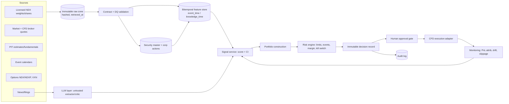

# Nasdaq-100 CFD Agent — Engineering & Investment-Committee Review

**Date:** 2026-11-13
**Reviewer role:** Principal engineer / quantitative PM
**Repo state:** single commit (`e8c4d1a`), no CI, no backtests, no risk policy on disk.

**Evidence tags:** `[V]` verified by running code/feeds, `[C]` read in source, `[U]` unverified/recalled — confirm before relying on it.

---

## 0. Verdict

**Research prototype / advisory demo — maturity ≈ 1 of 5. Do not deploy against live capital.**

The system is an honest, well-structured demo whose recommendation is produced by **Claude's discretion**, not by a measured, validated edge. Its data is not point-in-time, its "risk controls" are partly LLM-supplied, and nothing is reproducible or audited. It correctly labels itself "advisory, not backtested".

---

## 1. System map

```
Streamlit UI / CLI
      -> agent loop (Claude tool-use, max 25 turns)   src/ndx_agent/agent/loop.py
            -> MCP client (stdio)
                  -> MCP server (21 tools)             src/ndx_agent/mcp_server/server.py
                        -> data providers (disk TTL cache)  src/ndx_agent/data/*.py
```

- **Data sources:** yfinance (prices, estimates, calendar, options), Invesco QQQ holdings, Wikipedia (fallback, no weights), FRED, Finnhub (optional), NewsAPI (optional), Yahoo RSS, CFTC COT, SEC EDGAR.
- **Refresh cadence:** on-demand with TTL caches of 15 min (prices/options) to 24 h (EDGAR CIK map).
- **Decision flow:** prompt instructs a fixed analysis order; the model calls tools, then `submit_recommendation`. The loop attaches a **code-computed** risk plan and rejects a BUY/SELL submitted without a matching `compute_risk_levels` result.
- **Controls:** one hard gate (risk plan required for directional calls); one validation (pydantic draft schema). No limits, kill switch, logging, or persistence.

---

## 2. What is already strong (keep)

1. **Model cannot type the stop/target/size directly** — the loop computes and attaches them. `[C]` loop.py, risk.py
2. **Position sizing rounds down**, so a clean stop-out cannot exceed planned risk before gaps. `[C]` risk.py
3. **Graceful degradation** — provider failures become `{error, source_unavailable}`; missing score components are renormalised and coverage reported. `[C]` _util.py, aggregation.py
4. **HOLD-biased prompt** — mixed evidence defaults to HOLD; stale data must lower confidence. `[C]` prompts.py
5. **Clean MCP seam** — the data layer is swappable and reusable by other MCP clients.
6. **Candid limitations** in the README and 13 passing offline unit tests. `[V]`

---

## 3. Top 10 risks (ranked)

| # | Risk | Evidence |
|---|---|---|
| 1 | **No demonstrated edge.** Signal weights (0.35/0.35/0.30), ±0.15 labels, ±10% saturation are arbitrary & unvalidated; no rule maps score→action — the LLM decides. | `[C]` aggregation.py, prompts.py |
| 2 | **Weights are a wrong ETF proxy.** Invesco feed has 106 rows; `securityTypeCode=="COM"` keeps 98 and **drops ASML, ARM, PDD** (~1.26% combined); kept names sum to **98.585%**, not 100. | `[V]` constituents.py |
| 3 | **Not point-in-time.** yfinance estimates/history and FRED values are latest-revised snapshots; COT keyed on Tuesday date but published Friday. Backtesting impossible. | `[C]` data/*.py |
| 4 | **Risk limits enforced by LLM inputs, not code.** `compute_risk_levels` exposes `account_size`, `risk_pct`, `leverage`, `stop_atr_mult`, `reward_risk`; the loop never checks them vs the user's request. Margin breach is only a warning string. | `[C]` risk.py, loop.py |
| 5 | **Not reproducible/auditable.** No run id, timestamp, model version, input hash, or tool-output snapshot; default temperature; unpinned model alias; trace lives only in Streamlit session_state. | `[C]` loop.py |
| 6 | **Cached silent failure.** `_constituent_inputs` swallows exceptions, returns zeros/empties; `ttl_cache` stores the empty "success" for 6 h — a transient yfinance error becomes a momentum-only score that looks valid. | `[C]` aggregation.py, cache.py |
| 7 | **Biased signal inputs.** Surprise = mean of last 4 beats (mega-caps beat ~75% → bullish base rate); revisions = raw counts across 0q/+1q/0y/+1y, no magnitude; momentum double-counts the agent's own technicals. | `[C]` aggregation.py |
| 8 | **Event-risk claim unbacked.** Prompt cites "CPI/FOMC if known from tools" but no macro/rebalance/expiry calendar tool exists; earnings lack BMO/AMC flag and use machine-local `date.today()`. | `[C]` prompts.py, fundamentals.py |
| 9 | **Untrusted text reaches a tool-using LLM.** News headlines & SEC excerpts enter context unfiltered; evidence "must cite a tool" is not verified against the trace; confidence uncalibrated. | `[C]` news.py, filings.py, loop.py |
| 10 | **Unit bug.** `get_macro_dashboard` labels everything `chg_20_obs`; for monthly series (FEDFUNDS, UNRATE) that is a 20-**month** change the LLM reads as 20 days. | `[V]` macro.py |

---

## 4. Core questions — answers

1. **What determines BUY/SELL today?** Claude's judgment after ~10–25 tool calls. The only quantitative composite (`compute_index_earnings_impact`) is descriptive, with no score→action rule.
2. **Directional/sized/time-bounded/risk-aware?** Directional ✔; sized ✔ (risk per 2×ATR14 stop); time-bounded ✘ (constant horizon string, no time stop); risk-aware only partly.
3. **Idea vs executable decision?** Not distinguished — one object is both; no quote, validity window, or order state.
4. **Official weights?** No — QQQ fund proxy; ADRs dropped; Wikipedia fallback has no weights (index score silently `None`).
5. **Models index impact correctly?** No — weight-average of heuristic scores, not an index-return estimate; no price-reaction, "priced-in", or post-rebalance weight.
6. **Concentration risk?** Implicit only. Today top5=30.3%, top10=46.5%, top25=71.4% `[V]`; no caps, no correlation/cluster model; `top_n=25` ignores ~29% of the index.
7. **Point-in-time?** No (see risk 3).
8. **Session/earnings/macro regimes?** No — "regime" = SMA position; daily data only.
9. **CFD constraints?** Barely — stop-based size + margin=notional/leverage (warning only); no spread, financing, slippage, gap model, broker margin, or leverage cap.
10. **Out-of-sample evaluation?** None.
11. **Deterministic reproducibility?** No.
12. **What fails first?** See §5.

---

## 5. Production failure modes

| Event | First failure |
|---|---|
| Earnings surge | 6 h cache serves pre-print estimates; BMO/AMC timing unknown; can recommend into a gap the 2×ATR stop won't cover. |
| Rebalance / reconstitution | Weights lag ≥1 day and ignore post-event targets; agent unaware of the date. |
| Dislocation | Lagging ATR14 mis-sizes the stop; partial intraday bar likely used as "last close" `[U]`; no spread/gap model; no VIX/data-stress halt. |
| Data outage | yfinance (unofficial scraper; single point of failure for prices/estimates/calendar/options) fails → thinner-evidence recommendation, no hard stop. |
| Hallucinated tool output | Nothing verifies cited evidence vs trace; a prompt-injected headline can steer the model. |
| Rate limits | 25 names × several synchronous yfinance calls → 429s swallowed by the cached-empty bug (risk 6). |

---

## 6. Layer audit

| Layer | Finding | Severity |
|---|---|---|
| Market data | yfinance only; no quote timestamp/staleness/session check; no exchange calendar; `auto_adjust` vs unadjusted ATR; no cross-source check. | High |
| Reference data | No security master; ADRs & share classes (GOOG/GOOGL) ad hoc; no ticker-change/delisting history. | High |
| Index construction | Fund proxy; no share counts/float; no capping; no rebalance calendar. | High |
| Corporate actions | Delegated to yfinance adjustment; no index-level handling. | Med |
| Fundamentals | Snapshots, no vintage; trailing-4Q surprise; un-normalised revision counts; `surprisePercent` fraction-vs-percent unit unverified `[U]`. | High |
| News / LLM sentiment | Keyword lexicon ("cut" scored negative, also hits bullish "rate cut"); no timestamp normalisation/entity resolution/injection defence; source mix varies with keys. | Med |
| Macro | Revised FRED values; no release calendar/vintages; monthly/daily unit bug; no surprise-vs-consensus. | High |
| Options / vol | QQQ proxy for NDX; European BS, hard-coded r=4.5%, no dividends; calendar-day T; nearest-strike skew; can use stale last trades; VXN & NDX/NDXP unused. | Med |
| Execution / liquidity | None (no spreads, financing, broker margin tiers). | High |
| Risk / portfolio | Per-trade only; no portfolio/exposure limits, event blackout, gap model, or kill switch. | **Critical** |
| Backtest / eval | None. | **Critical** |
| Observability | None (no logs, metrics, drift, freshness SLAs). | High |
| Security / governance | Pickle disk cache (RCE risk if shared); unpinned deps; API keys in query strings (leak via logs/errors); no auth on Streamlit (shared Anthropic key); no model-change control. | Med |

---

## 7. Target architecture



**Build vs buy:** *Buy* official index weights (Nasdaq GIDS/LSEG/FactSet), market+options data (Databento/Polygon/OPRA), PIT estimates (I/B/E/S/FactSet/Zacks), earnings-timing calendar, broker API/OMS. *Build* the raw zone/feature store (thin: Parquet/Delta + DuckDB + as-of joins), the signal/portfolio/risk engines (the IP), and the LLM extractor. Keep QQQ proxy only as a **labelled fallback**.

**Separation (currently conflated):** signals emit `(score, CI, horizon)` → portfolio construction emits target exposure → risk clips it → decision record written → human approves → execution adapter places. **A BUY is a risk-approved decision record, never an LLM output.**

---

## 8. Gap analysis

| Area | Current | Target | Sev | Effort | Dependency | First action |
|---|---|---|---|---|---|---|
| Index weights | QQQ fund, ADRs dropped, 98.6% | Official/licensed + confidence label | Crit | M | Vendor | Fix ADR filter; add `weights_confidence`; assert Σ=100±0.5 |
| Point-in-time | Snapshots | Bitemporal store | Crit | L | Vendor data | Persist raw responses with `retrieved_at` now |
| Backtest | None | Walk-forward + CFD costs | Crit | L | PIT data | Write §10 protocol before more signals |
| Risk enforcement | LLM-supplied params, warnings | Code-enforced limits, hard rejects | Crit | S | None | Pin sizing params from request; reject margin > limit |
| Audit/repro | None | Immutable decision records | Crit | S | None | Add run_id, timestamp, model id, tool-output hashes |
| Cache semantics | Swallowed errors cached | Cache only validated; as-of in payload | High | S | None | Re-raise in `_constituent_inputs`; add `retrieved_at` |
| Event calendars | Earnings only (weak) | Earnings(BMO/AMC)+macro+rebalance+expiry | High | M | Calendar vendor | Deterministic calendar tool + pre-trade check |
| CFD costs | Warning text | Spread/financing/gap/margin from broker | High | M | Broker API | Parameterise spread & financing into R-multiples |
| Signal validity | Arbitrary weights | Pre-registered signals + CIs | High | L | Backtest | Freeze current score as "baseline v0" |
| LLM governance | Prompt only | Schema + citation + injection hardening | High | M | None | Verify each evidence item vs the trace |
| Observability | None | Freshness/error/distribution metrics | High | M | Platform | Structured JSON logs per tool call |
| Tests | 13 unit + 2 live (fake LLM) | Contract/golden/regression | Med | M | Fixtures | VCR fixtures + constituent-parser test |
| Security | Pickle, unpinned, no auth | Safe serialisation, lockfile, RBAC | Med | S | None | Replace pickle; add lockfile; keys in headers |

---

## 9. Prioritised roadmap

Effort: S ≤1 wk, M 2–6 wk, L 6+ wk (one engineer).

### Phase 0 — Stabilise & make safe (wk 0–3)
- Fix constituent integrity (include ADR/DRNY, exclude cash/futures, assert Σ≈100, flag proxy). **S**
- Code-pin risk params (inject `account_size`/`risk_pct`/`leverage` from request; ignore model values; hard-cap leverage/margin). **S**
- Immutable decision record (inputs, tool outputs, model id, prompt hash, time, plan). **S**
- Cache & `retrieved_at` hygiene (raise on failure; embed as-of in outputs). **S**
- Fix `chg_20_obs` unit naming by frequency. **S**
- Evidence verification against tool-call ids. **S**
- Mark "advisory, paper-only" in code (no-execution gate). **S**
- **Stop doing:** presenting `confidence` as a probability; `top_n=25` without a coverage gate; calling the score "earnings impact"; trusting the README claim about model-controlled sizing.

### Phase 1 — Trustworthy evaluation (wk 3–14)
- PIT data landing zone (archive raw daily; then buy PIT estimates/weights). **L**
- Backtest harness (event-driven, walk-forward, CFD costs, regime tags, leakage tests). **L**
- Baselines + stats (DSR/SPA/PBO). **M**
- Forward paper-trading ledger (LLM cannot be safely backtested — contamination). **M**

### Phase 2 — Index-aware alpha (mo 3–6)
- Index impact engine `ΔI ≈ Σ wᵢ·E[rᵢ]` with covariance-aware risk. **M**
- Event signals (earnings normalised to implied move; guidance; revisions w/ magnitude). **L**
- Deterministic calendar tool. **M**
- LLM as structured extractor; code decides direction. **M**

### Phase 3 — Institutional risk & execution (mo 5–9)
- Risk engine (portfolio limits, event blackout, gap-risk, kill switch). **M**
- CFD cost model (spread/financing/slippage from broker). **M**
- Pre-/post-trade checks (stale price, spread, margin, event, quote-age → hard rejects). **M**
- Human approval gate w/ override. **S**

### Phase 4 — Scale & improve (mo 9–12+)
Model governance (champion/challenger, drift, decay), PnL attribution, DR/runbooks, RBAC/secrets vault, staged rollouts, capacity analysis before scaling capital.

---

## 10. Nasdaq-100-specific design

- **Universe table** keyed on a stable security id (not ticker): share class, ADR flag, share count, float factor, price, `index_weight`, `weight_source`, `weight_confidence`, `as_of`, `knowledge_time`. Reconcile before use: Σw≈100, ~100 companies / ~101 securities (GOOG+GOOGL both held), no cash/futures lines.
- **Weights:** primary = licensed official; secondary = reconstruct from shares×price reconciled to official; fallback = QQQ proxy, low-confidence label that widens CIs / blocks sizing downstream.
- **Constituent → index impact:** contribution = `wᵢ × E[rᵢ | info]`, not EPS. Input is **surprise vs market-implied expectation** (consensus, whisper, options-implied move, pre-print run-up), not the beat flag. Reaction horizon 1–3 days; aggregate with covariance (marginal contribution to index variance), capping risk per mega-cap cluster (AAPL/MSFT/NVDA/AMZN/META/GOOG; semis NVDA/AMD/MU/AVGO…).
- **Earnings/guidance/revisions/macro:** earnings need BMO/AMC flag + size cap/blackout; guidance usually drives reaction more than EPS (LLM-extract to schema, code-judge); revisions need magnitude/breadth/dispersion/horizon; macro enters as regime/blackout first, alpha only after validation (decompose real-yield + breakevens).
- **Rebalance/reconstitution:** quarterly (3rd Fri Mar/Jun/Sep/Dec) + annual December reconstitution + capping rules **[U — confirm against current Nasdaq methodology]**. Maintain a calendar + "pending weight change" table so signals use expected post-event weights; flag close-auction flow windows as a distinct regime.
- **Avoid mega-cap overfitting:** cross-sectional evaluation with leave-top-k-out; require effect to survive removing the top 5 weights; report equal-weight shadow index; use effective-N-of-bets (PCA/risk model).
- **CFD constraints to model explicitly:** variable spread (widens at open/close/events); overnight financing (benchmark ± markup × notional × holding days); tiered broker margin (retail caps jurisdiction-specific, e.g. ESMA 20:1 on major indices `[U]`); gap/slippage (stops not guaranteed — check for guaranteed stops); ~24 h session w/ thin off-hours liquidity; broker counterparty/quote-source mismatch — signal on the instrument you trade.

---

## 11. Evaluation plan

**Hard rules (reject any violating result):** point-in-time data; survivorship-free universe; fills at next executable price + spread; financing on every overnight.

**Splits:** purged+embargoed walk-forward (embargo ≥ label horizon); one untouched final holdout (last 12–18 mo, opened once); regime slices (VIX>25, earnings-heavy, rate-shock, drawdown).

**Power warning:** 5-day horizon × 10 yr ≈ 520 non-overlapping index obs; 55% hit rate SE ≈ 2.2 pts → index-level direction is under-powered. Prefer cross-sectional constituent tests and shorter-horizon event studies.

**LLM contamination:** an LLM tested inside its training window has seen outcomes. Backtest only the deterministic signals; evaluate the LLM layer via forward ledger + extraction accuracy on post-cutoff data.

**Metrics:** rank IC (by horizon + decay curve); hit rate (secondary); net Sharpe/Sortino; max drawdown + time under water; turnover; capacity; slippage-adjusted PnL; calibration (reliability curve); attribution by signal/cluster/constituent/time-of-day/vol regime.

**Baselines (after costs):** buy-and-hold NDX CFD (financing in); vol-targeted long; 50/200 trend; cap-weighted constituent momentum; v0 score as a pure rule (no LLM); random entry with matched turnover/holding.

**Tests:** Newey-West t on IC; stationary bootstrap CIs; White Reality Check / Hansen SPA across the signal set; Deflated Sharpe Ratio; PBO (CSCV); Benjamini-Hochberg FDR over the signal library. Stress: delayed/missing feeds, missing earnings, ±5σ gaps, spread blow-out.

**Gates before live capital (starting points — ratify with risk committee):**

| Gate | Threshold |
|---|---|
| OOS net IC | > 0, t > 2.5 after multiple-testing correction |
| Net Sharpe vs best baseline | SPA p < 0.05 and DSR > 0.95 |
| Max drawdown | Within risk budget in every regime slice |
| Calibration | Reliability slope within ±0.2 of 1 |
| Live-to-sim | Paper ledger ≥ 6 mo, Sharpe ≥ 50% of backtest |
| Operational | 0 limit breaches, 0 stale-data orders for 60 days |

---

## 12. 30/60/90-day plan

- **0–30 — make it safe.** Ship all Phase 0 items; start archiving raw payloads daily; write the research protocol + signal registry; pin deps + model version; temperature 0; add lockfile. **Measure:** % runs with complete data, tool error rate, cache staleness, BUY/SELL/HOLD distribution.
- **31–60 — build evaluation.** Buy PIT estimates + weight history; build backtest harness w/ leakage tests + CFD cost model; start forward paper ledger; add deterministic calendar. **Measure:** leakage-test pass rate, ledger fill rate, early calibration.
- **61–90 — first honest result.** Run baselines + v0 score through the full protocol; report net, CI-bounded results; prototype the index-impact engine on official weights.
  - **Gate A (day 90):** if v0 doesn't beat baselines after costs, stop investing in the LLM decision layer; redirect to signals + the extractor role.
  - **Gate B:** no capital/automation increase until §11 gates pass; advisory → human-approved paper execution requires the Phase 3 risk engine + kill switch tested.

---

## 13. Smallest, highest-value first PRs

1. **Constituent filter + Σ=100 assertion + proxy flag** (fixes a wrong universe). `constituents.py`
2. **Code-pin risk parameters from the request** (closes the LLM-sizing gap). `loop.py`, `risk.py`
3. **Decision record with run_id/timestamp/model/hashes** (enables audit + repro). `loop.py`, `models.py`
4. **Re-raise in `_constituent_inputs` + `retrieved_at` in outputs** (kills cached-empty bug). `aggregation.py`, `cache.py`, `_util.py`
5. **Rename `chg_20_obs` by frequency** (removes the unit trap). `macro.py`

Each is small, testable, and independently shippable.
